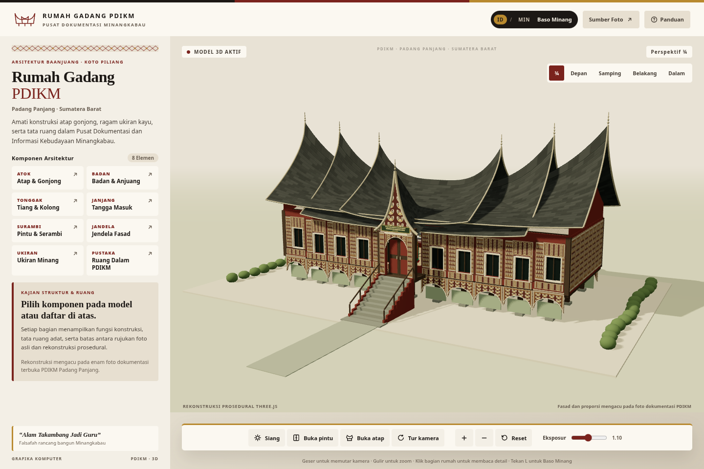
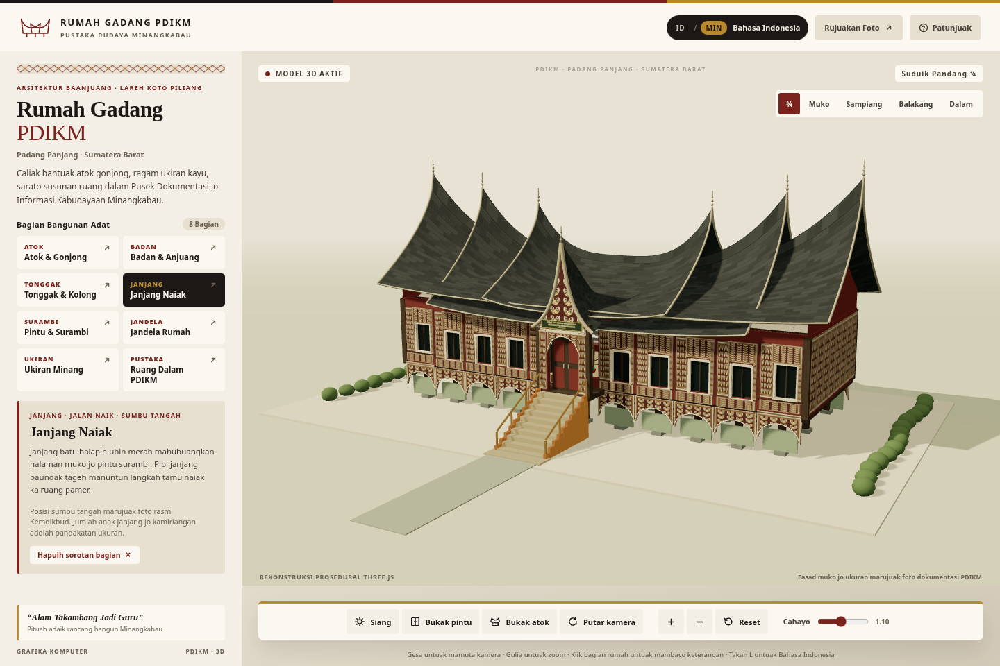
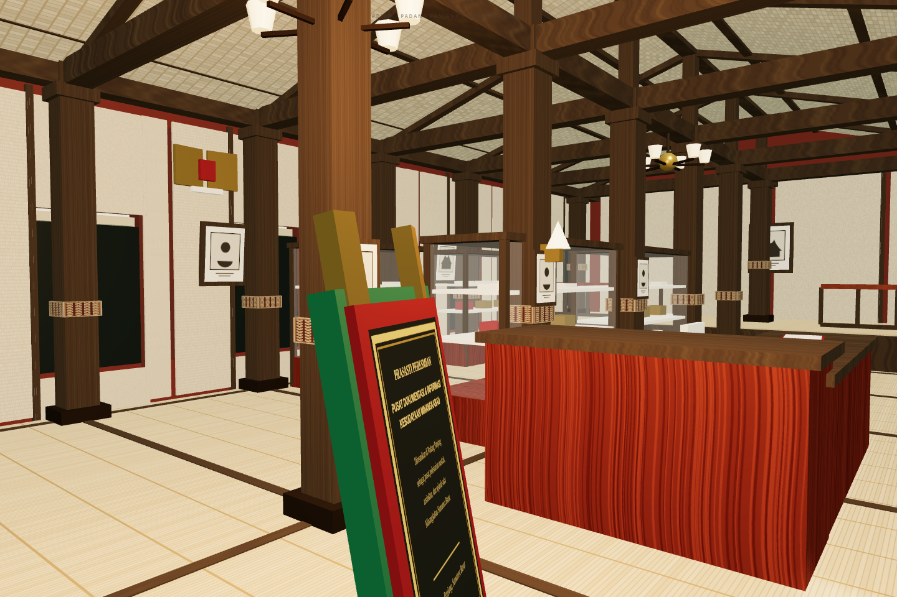
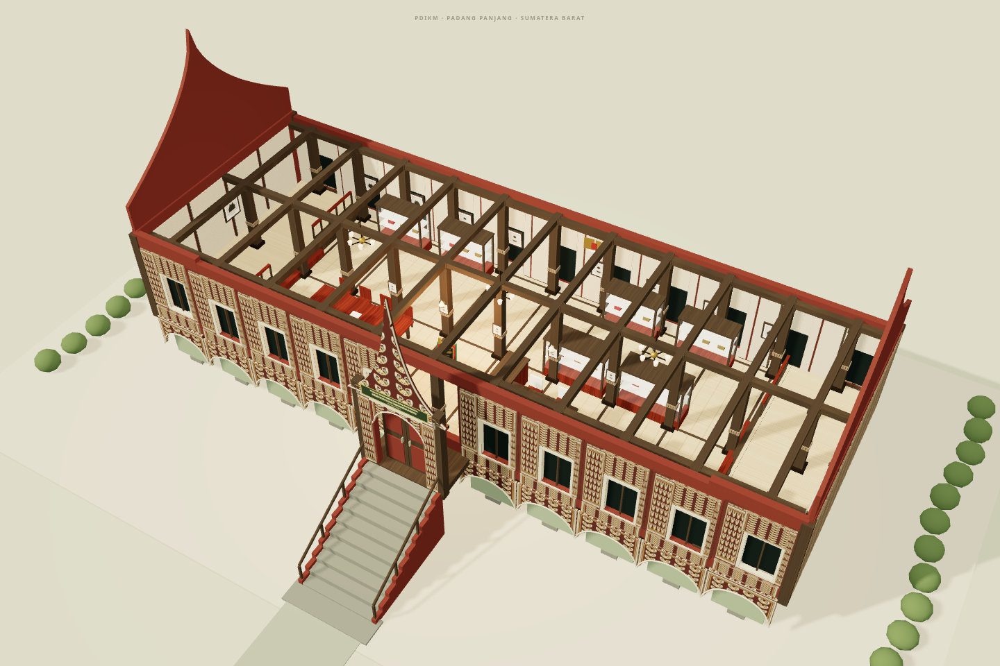
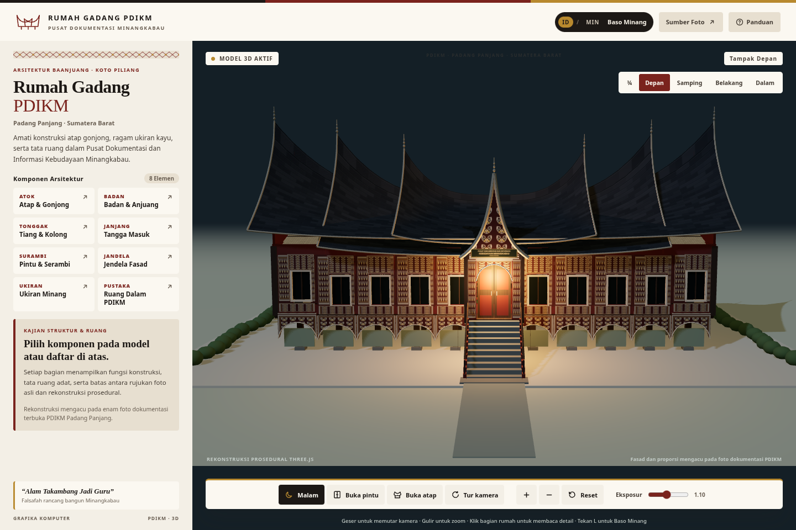

# Rumah Gadang 3D Interaktif — PDIKM Padang Panjang

Aplikasi web 3D interaktif berbasis **Three.js + TypeScript + Vite** yang merekonstruksi bangunan utama **Rumah Gadang Pusat Dokumentasi dan Informasi Kebudayaan Minangkabau (PDIKM)** di Padang Panjang, Sumatera Barat, lengkap dengan interior ruang pamer, antarmuka khas **Marawa Tiga Warna**, serta alih bahasa **Bahasa Indonesia (`ID`) ↔ Baso Minang (`MIN`)**.

> **Live Demo (Firebase Hosting):** <https://rumah-gadang-pdikm.web.app>



<details>
<summary>Pratinjau Mode Baso Minang, Ruang Dalam (Interior), dan Mode Malam</summary>

| Mode Baso Minang (`MIN`) | Ruang Dalam (`Interior`) |
|---|---|
|  |  |

| Mode Potong Atap (`Cutaway`) | Mode Malam (`Night Lighting`) |
|---|---|
|  |  |

</details>

## Tautan presentasi dan demonstrasi kelompok

Tempelkan tautan video kelompok pada kolom di bawah ini sebelum pengumpulan:

- **Aplikasi langsung (Firebase Hosting):** <https://rumah-gadang-pdikm.web.app>
- **Tautan video presentasi & demo:** `[TEMPEL_TAUTAN_VIDEO_KELOMPOK_DI_SINI]`
- **Draf salindia presentasi:** [`docs/presentasi.md`](./docs/presentasi.md)

## Struktur direktori proyek

```text
.
├── .github/workflows/ci.yml      # Pipeline GitHub Actions (typecheck, build, Playwright E2E)
├── docs/
│   └── presentasi.md             # Draf salindia presentasi & slot tautan video kelompok
├── evidence/
│   ├── final/                    # Tangkapan layar verifikasi lintas sudut & ukuran layar
│   └── test-results.json         # Laporan hasil uji terotomasi Playwright (20/20 pass)
├── public/
│   └── favicon.svg               # Ikon tab situs bernuansa Marawa
├── references/
│   ├── photos/                   # Enam foto referensi asli Wikimedia Commons (objek tunggal)
│   ├── metadata.json             # Metadata terstruktur & hash SHA-256 foto referensi
│   └── sources.md                # Sumber asli, fotografer, lisensi, tanggal akses, dan asumsi
├── scripts/
│   ├── lib/find-chromium.mjs     # Resolver portabel Chromium lintas OS & CI
│   ├── capture.mjs               # Skrip tangkapan layar multi-sudut
│   ├── fetch-references.py       # Pengunduh ulang foto referensi & pembuat metadata SHA-256
│   ├── package-source.py         # Pengemas ZIP sumber tanpa node_modules & artefak build
│   ├── sync-references.mjs       # Penyinkron references/ ke public/references/ saat dev/build
│   └── test-browser.mjs          # Suite pengujian WebGL & responsivitas Playwright
├── src/
│   ├── model/
│   │   ├── house.ts              # Geometri prosedural eksterior (gonjong, badan, tonggak, ukiran)
│   │   ├── interior.ts           # Geometri interior ruang pamer, prasasti, etalase, dan plafon
│   │   ├── materials.ts          # Tekstur kanvas prosedural, bumpMap, dan MeshStandardMaterial
│   │   ├── merge-static.ts       # Penggabungan geometri statis per material untuk optimasi draw calls
│   │   └── parts.ts              # Kamus dwibahasa ID/MIN serta metadata 8 komponen arsitektur
│   ├── main.ts                   # Scene Three.js, pencahayaan, raycasting, animasi, dan UI
│   ├── style.css                 # Sistem desain Marawa & Songket responsif
│   └── vite-env.d.ts             # Deklarasi tipe Vite
├── .editorconfig
├── .firebaserc                   # Target proyek Firebase Hosting (rumah-gadang-pdikm)
├── .gitattributes
├── .gitignore
├── firebase.json                 # Konfigurasi hosting & header keamanan CSP
├── index.html                    # Dokumen HTML utama
├── package.json
├── package-lock.json
└── tsconfig.json
```

> Catatan: Direktori `public/references/` disalin otomatis dari `references/` saat `npm run dev`, `npm run build`, atau `npm run test:e2e`, sehingga tidak diduplikasi di dalam repositori Git.

## Lingkungan pengembangan

Pemeriksaan lingkungan pengembangan pada **Linux CachyOS** mencatat versi perangkat lunak berikut:

| Komponen | Versi terpasang | Keterangan |
|---|---|---|
| Sistem operasi | CachyOS Linux (rolling, berbasis Arch Linux) | Kernel `7.2.6-1-cachyos` (`x86_64`) |
| Manajer paket | `pacman 7.1.0` (`libalpm v16.0.1`) | Repositori resmi CachyOS/Arch |
| Node.js | `v22.23.3` | Memenuhi syarat `>=22.12.0` |
| npm | `10.9.9` | Manajemen paket & `package-lock.json` |
| Git | `2.55.0` | Kendali versi |
| Peramban uji | Chromium `153.0.8010.12` (Playwright) | Pengujian headless WebGL |
| FFmpeg | `n9.0.1` | Pengolahan video demonstrasi |

Pada instalasi baru CachyOS/Arch Linux tanpa perkakas dasar, pasang paket resmi berikut (tanpa AUR):

```bash
sudo pacman -Syu --needed nodejs npm git chromium ffmpeg
```

## Cara instalasi dan menjalankan

Masuk ke direktori akar proyek, lalu jalankan perintah berikut:

1. **Pasang dependensi:**
   ```bash
   npm install
   ```
   Memasang `three@0.187.0`, `@types/three@0.187.0`, `typescript@7.0.2`, `vite@8.3.5`, dan `@playwright/test@1.64.1` sesuai `package-lock.json`.

2. **Jalankan server pengembangan lokal:**
   ```bash
   npm run dev
   ```
   Skrip `predev` otomatis menyinkronkan foto referensi ke `public/references/`, lalu Vite menyajikan aplikasi di `http://localhost:5173`.

3. **Pemeriksaan tipe dan *build* produksi:**
   ```bash
   npm run build
   ```
   Menjalankan `tsc --noEmit` dan membungkus berkas siap produksi ke direktori `dist/`.

4. **Jalankan pengujian peramban terotomasi (Playwright E2E):**
   ```bash
   npx playwright install chromium   # hanya perlu sekali pada mesin baru
   npm run test:e2e
   ```
   Menjalankan seluruh skenario pengujian pada *build* produksi, memperbarui tangkapan layar di `evidence/final/`, dan menulis hasil ke `evidence/test-results.json`.

5. **Kemas kode sumber ke arsip ZIP (tanpa `node_modules`):**
   ```bash
   npm run package
   ```
   Menghasilkan `rumah-gadang-3d-interaktif-source.zip` untuk keperluan pengumpulan arsip.

6. **Deploy ke Firebase Hosting:**
   ```bash
   npm run deploy
   ```

## Fitur utama

1. **Model 3D prosedural 8 komponen semantik ([`src/model/`](./src/model/)):**
   - `roof` (**ATOK · Atap & Gonjong**): Tiga pasang atap pelana melengkung enam gonjong utama, gonjong ketujuh serambi, lis perak, dan mahkota puncak.
   - `body` (**BADAN · Badan & Anjuang**): Lantai panggung berundak, dinding papan merah tua miring keluar, teluk ujung (*anjuang*) lebih tinggi di kiri-kanan, dan bidang *gable*.
   - `pillars` (**TONGGAK · Tiang & Kolong**): 33 tiang penopang pada grid $11 \times 3$, batu sandi, kisi bambu kolong, dan lengkungan bawah.
   - `stairs` (**JANJANG · Tangga Masuk**): Tangga batu bersumbu tengah dengan pipi tangga merah bata dan pegangan kayu.
   - `doors` (**SURAMBI · Pintu & Serambi**): Serambi berukir di bawah papan nama PDIKM dan dua daun pintu berengsel yang dapat berputar membuka dan menutup.
   - `windows` (**JANDELA · Jendela Fasad**): Bukaan kaca berbingkai krem dengan kisi kayu di sepanjang fasad serta jendela sudut *anjuang*.
   - `ornaments` (**UKIRAN · Ukiran Minang**): Motif sulur prosedural (*Aka Cino*, *Pucuak Rabuang*, *Itiak Pulang Patang*) dan papan nama PDIKM.
   - `interior` (**PUSTAKA · Ruang Dalam PDIKM**): Lantai tikar rotan, panggung *anjuang*, plafon miring anyaman bambu (`ceilingGroup` yang dapat dibuka via mode potong atap), tiga lampu gantung bercabang enam, prasasti peresmian, meja tamu mahoni, enam etalase kaca, bingkai foto arsip, dan meja baca perpustakaan.

2. **Pencahayaan, bayangan, dan material PBR ([`src/main.ts`](./src/main.ts), [`src/model/materials.ts`](./src/model/materials.ts)):**
   - Kombinasi `HemisphereLight`, `AmbientLight`, dan matahari terarah `DirectionalLight` berbayangan lembut (`PCFShadowMap` $2048 \times 2048$).
   - Transisi halus mode Siang/Malam yang mengubah warna langit, kabut, arah/warna cahaya matahari, dan menyalakan `PointLight` hangat di serambi maupun ruang dalam.
   - *Tone mapping* `ACESFilmicToneMapping` dengan penggeser eksposur ($0{,}50$–$1{,}80$).

3. **Antarmuka khas Minangkabau & Mode Dwibahasa `ID` / `MIN` ([`src/style.css`](./src/style.css), [`src/model/parts.ts`](./src/model/parts.ts)):**
   - Palet **Marawa Tiga Warna** (*Hitam Siriah* `#1c1815`, *Merah Kesumba* `#7a231d`, *Kuning Kunyik* `#b8892e`) dan ornamen tenun **Pucuk Rebung**.
   - Tombol alih bahasa `ID / MIN` atau pintasan keyboard **`L`** menerjemahkan seluruh antarmuka, kontrol, panduan, sumber foto, serta kedelapan komponen arsitektur ke dalam **Baso Minang** asli.
   - Mendukung penuh mouse, layar sentuh satu/dua jari (*pinch* & *pan*), serta responsif dari layar lebar ($1440 \times 960$) hingga ponsel ($360 \times 740$ dan lanskap $844 \times 390$).

## Daftar kontrol pengguna

| Aksi | Mouse / Layar sentuh | Tombol UI | Pintasan papan ketik |
|---|---|---|---|
| Putar kamera $360^\circ$ (*orbit*) | Geser klik kiri / 1 jari | Sudut `¾`, `Depan`, `Samping`, `Belakang`, `Dalam` | `I` (ruang dalam) |
| Perbesar / perkecil (*zoom*) | *Scroll wheel* / cubit 2 jari | Tombol `+` dan `−` | - |
| Geser kamera (*pan*) | Geser klik kanan / 2 jari | - | - |
| Reset kamera | - | Tombol `Reset` | `R` |
| Pilih & sorot komponen | Klik / ketuk bagian model 3D | Kartu `ATOK` s.d. `PUSTAKA` | `Esc` (lepas sorotan) |
| Alih bahasa `ID` ↔ `MIN` | - | Tombol `ID / MIN Baso Minang` | `L` |
| Buka / tutup pintu | - | `Buka pintu` / `Tutup pintu` | `D` |
| Buka / tutup atap (*cutaway*) | - | `Buka atap` / `Tutup atap` | `C` |
| Ganti mode siang / malam | - | `Siang` / `Malam` | `N` |
| Mulai / hentikan tur kamera | Sentuh kanvas untuk berhenti | `Tur kamera` / `Hentikan tur` | `T` |
| Atur kecerahan (*exposure*) | Geser *slider* `Eksposur` | `0.50` – `1.80` | Panah kiri/kanan saat fokus |
| Buka panduan & sumber foto | - | `Panduan` dan `Sumber Foto` | `Esc` (tutup dialog) |

## Sumber foto referensi

Seluruh foto referensi disimpan di [`references/photos/`](./references/photos/) dengan metadata SHA-256 di [`references/metadata.json`](./references/metadata.json) serta dokumentasi atribusi di [`references/sources.md`](./references/sources.md). Keenam foto menampilkan satu bangunan nyata yang sama (**Rumah Gadang PDIKM Padang Panjang**, diakses 3 November 2026):

1. **`pdikm-official.jpg`** — Tampak depan utama ([Kemdikbud RI](https://commons.wikimedia.org/wiki/File:Rumah_Gadang_Minangkabau_PDIKM,_Padang_Panjang.jpg), Domain Publik `PD-IDGov`)
2. **`pdikm-center.jpg`** — Sudut dekat atap, fasad, dan kolong ([Detlef Langer](https://commons.wikimedia.org/wiki/File:Minangkabau_Center.JPG), `CC BY-SA 3.0`)
3. **`pdikm-view-2.jpg`** — Sudut tiga perempat halaman depan ([Pemkot Padang Panjang](https://commons.wikimedia.org/wiki/File:Pdikm_padangpanjang_2.jpg), `PD-IDGov`)
4. **`pdikm-view-3.jpg`** — Serambi depan, tangga, dan sayap kanan ([Pemkot Padang Panjang](https://commons.wikimedia.org/wiki/File:Pdikm_padangpanjang_3.jpg), `PD-IDGov`)
5. **`pdikm-carving.jpg`** — Detail ukiran dinding dan kolong ([Pemkot Padang Panjang](https://commons.wikimedia.org/wiki/File:Rumitnya_Ukiran_Minang.jpg), `PD-IDGov`)
6. **`pdikm-interior.jpg`** — Ruang pamer dalam PDIKM ([`SpartacksCompatriot`](https://commons.wikimedia.org/wiki/File:Inside_the_PDIKM.JPG), `CC BY-SA 3.0`)

## Asumsi model dan keterbatasan

1. **Sisi belakang dan samping murni adalah asumsi rekonstruksi:** Sumber foto terbuka menampilkan fasad depan, serambi, sudut tiga perempat depan, detail ukiran, dan ruang pamer dalam, tanpa dokumentasi sisi belakang atau tampak samping tegak lurus. Sisi belakang dan samping dibangun simetris mengikuti modul fasad depan dan ditandai eksplisit pada UI (`Tampak belakang · asumsi`).
2. **Proporsi berbasis pengamatan visual foto:** Ukuran model memakai skala pendekatan ($1\text{ unit} \approx 1\text{ meter}$) dari foto referensi, bukan gambar ukur lapangan.
3. **Tekstur dan motif ukiran prosedural:** Ukiran sulur, anyaman bambu, tikar rotan, dan prasasti digambar secara prosedural di kanvas 2D tanpa menempelkan potongan foto asli.
4. **Tata letak sudut interior & halaman luar:** Elemen tengah ruang dalam mengikuti `pdikm-interior.jpg`, sedangkan penataan ke sudut *anjuang* di luar cakupan kamera merupakan rekonstruksi simetris; dua bangunan *rangkiang* terpisah di halaman luar tidak dimodelkan.
5. **Mekanisme engsel pintu:** Sumbu engsel tepi dan sudut buka $\approx 86{,}4^\circ$ dirancang sebagai simulasi interaktif.

## Daftar periksa kelompok (minggu 10 dan minggu 16)

### Minggu 10 (persetujuan objek dan referensi)
1. Minta persetujuan dosen terkait pemakaian enam foto terbuka Wikimedia Commons (atau lengkapi foto sendiri bila diwajibkan, khususnya tampak belakang dan samping).
2. Isi daftar nama lengkap dan NRP anggota kelompok di [`docs/presentasi.md`](./docs/presentasi.md).

### Minggu 16 (demonstrasi akhir dan pengumpulan final)
1. Rekam video presentasi dan demo interaktif aplikasi (orbit $360^\circ$, zoom, pan, pemilihan 8 komponen, alih bahasa `ID / MIN`, tampilan interior & *cutaway*, animasi pintu, mode siang/malam, *exposure*, dan tur kamera).
2. Tempelkan tautan video pada `README.md` ini dan [`docs/presentasi.md`](./docs/presentasi.md).
3. Jalankan `npm run package` untuk menghasilkan arsip ZIP terbaru sebelum pengumpulan final.
